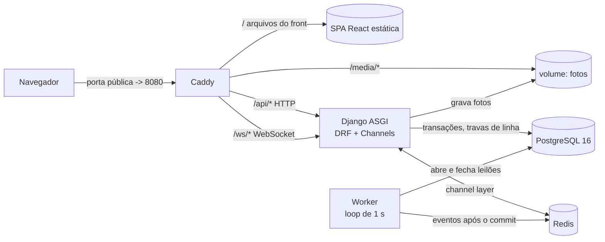

# Katchau — Leilão Online

Plataforma web de leilão em tempo real feita no Hackathon CATI Cloud Labs. O comitente anuncia um
item, os compradores disputam lances ao vivo e o leilão abre e fecha sozinho, com um vencedor.

> **Simulação:** nenhuma transação é real. Vencer um leilão conta como compra concluída.

**Sistema publicado:** http://200.18.99.113:8082

**Time Katchau:** Danilo (backend: modelos, estados, motor de lances, worker) · Amadeu (frontend:
todas as telas) · Bortoleto (deploy, docker compose, Caddy e WebSocket).

## Sumário

- [Como usar](#como-usar)
- [Contas de demonstração](#contas-de-demonstração-rnf04)
- [Arquitetura](#arquitetura)
- [Garantias e como são cumpridas](#garantias-e-como-são-cumpridas)
- [Decisões da equipe](#decisões-da-equipe)
- [O que foi entregue](#o-que-foi-entregue)
- [Como recriar o ambiente do zero](#como-recriar-o-ambiente-do-zero-rnf03)
- [Desenvolvimento local](#desenvolvimento-local)
- [Testes e verificação](#testes-e-verificação)
- [Estrutura do repositório](#estrutura-do-repositório)
- [Documentos](#documentos)

## Como usar

1. **Listagem** (pública): abas Em andamento, Agendados e Todos, com busca por nome e filtro por
   categoria. Cada cartão mostra foto, status, preço atual, número de lances e tempo restante.
2. **Criar conta / Entrar:** nome de exibição, e-mail e senha. A sessão dura 1 h e se renova com o uso.
3. **Anunciar item:** nome, descrição, categoria, preço inicial, início, duração e de 3 a 8 fotos.
4. **Sala do leilão** (exige login): preço atual, lance mínimo, líder, cronômetro e últimos lances,
   tudo atualizado ao vivo. O botão "Dar lance" já envia o lance mínimo; também dá para digitar um valor.
5. **Fim:** o leilão fecha sozinho no horário e todos na sala veem o resultado (vencedor e valor,
   ou "encerrado sem lances").

O comitente pode cancelar o próprio leilão enquanto ele está agendado, ou em andamento sem lances.
Ele entra na sala do próprio leilão, mas nunca pode dar lance nele.

## Contas de demonstração (RNF04)

Criadas por `seed_demo`. Senha de todas: `leilao-demo-2026`.

| Papel | E-mail | Nome |
|---|---|---|
| Comitente (dono dos 100 leilões) | `comitente@demo.test` | Carlos Comitente |
| Comprador | `ana@demo.test` | Ana Compradora |
| Comprador | `bruno@demo.test` | Bruno Comprador |
| Comprador | `carla@demo.test` | Carla Compradora |

São 100 leilões, cada um com 3 fotos:

| Status | Quantidade | Detalhe |
|---|---|---|
| Em andamento | 25 | 5 fecham em até 10 min |
| Agendados | 40 | 6 abrem em até 5 min e duram 3 min |
| Vendidos | 18 | |
| Encerrados sem lances | 9 | |
| Cancelados | 8 | |

Os lances de demonstração seguem as regras reais (lance mínimo, ninguém cobre o próprio lance,
comitente não dá lance). Rodar o comando de novo não duplica nada.

```bash
docker compose exec backend python manage.py seed_demo           # cria (se ainda não existe)
docker compose exec backend python manage.py seed_demo --reset   # recria com horários novos (antes da demo)
docker compose exec backend python manage.py seed_demo --photos  # só troca as fotos dos leilões existentes
```

As fotos dos itens vêm de `backend/auctions/seed_photos/`. A maioria é do Wikimedia Commons, com
licença livre; autores e licenças estão em
[`seed_photos/CREDITS.md`](backend/auctions/seed_photos/CREDITS.md).

## Arquitetura



| Peça | Tecnologia | Papel |
|---|---|---|
| Proxy | Caddy | Única porta exposta (8080). Serve o front, as fotos e repassa `/api` e `/ws`. Mesma origem: sem CORS. |
| Backend | Python, Django, Django REST Framework, Django Channels (daphne) | API REST, WebSocket da sala e regras de negócio. |
| Worker | `manage.py run_auction_worker` | Processo separado que abre e fecha leilões lendo o banco a cada 1 s. |
| Banco | PostgreSQL 16 | Fonte de verdade. Travas de linha garantem a ordem dos lances. |
| Tempo real | Redis | Distribui os eventos para todas as conexões da sala. Se cair, nenhum lance se perde. |
| Frontend | React, Vite, TypeScript, Tailwind | SPA estática, gerada no build da imagem do Caddy. |
| Fotos | Disco local da VM (volume Docker) | Só o caminho vai ao banco; nome do arquivo é um UUID. |

Tudo sobe com `docker compose up -d`. Detalhes, com o diagrama de sequência de um lance, em
[docs/architecture.md](docs/architecture.md). A API e os eventos do WebSocket estão em
[docs/contract.md](docs/contract.md).

## Garantias e como são cumpridas

| Requisito | Garantia | Como |
|---|---|---|
| RN01 | 5 estados, só 5 transições; com lances, só termina Vendido | Uma única função (`auctions/services/transitions.py`) altera o status e recusa qualquer transição fora da tabela. |
| RF10 | Lance só vale se as 4 condições forem verdadeiras **no processamento** | Dentro da transação e depois da trava, o servidor lê o relógio e confere: sessão, leilão em andamento e antes do fim, autor não é comitente nem líder, valor ≥ lance mínimo **de agora**. Toda recusa informa o motivo e o mínimo atual. |
| RF11 | Lances simultâneos nunca deixam o sistema inconsistente | `SELECT … FOR UPDATE` na linha do leilão serializa os lances; `UNIQUE(leilão, valor)` no banco é rede de segurança. A sala só recebe o evento depois do `COMMIT` (`transaction.on_commit`). |
| RF12 | Reenviar o mesmo lance não cria um segundo | O navegador manda um `Idempotency-Key` por tentativa. O resultado (aceite ou recusa) é gravado na mesma transação do lance, com `UNIQUE(usuário, chave)`; o reenvio devolve o resultado original. |
| RF15 | Sem vitória no último segundo, sem leilão infinito | Lance que deixa menos de 2 min: término vai para 2 min depois do lance, até no máximo 30 min além do término original. |
| RF16 | O horário que vale é o do servidor | O cronômetro da tela é só visual. O lance exige `agora < término`; o worker fecha com `agora >= término` (regras complementares, sem brecha). |
| RF17/18 | Abre e fecha sozinho, mesmo após reinício | O worker não guarda nada em memória: a cada segundo pergunta ao banco o que está atrasado. Usa a mesma trava do lance e `skip_locked`, então fechar duas vezes não duplica e nunca fecha no meio de um lance. |
| RF19 | Sem erro de arredondamento; horário certo em qualquer fuso | Dinheiro em centavos inteiros do banco à API. Datas em UTC no banco e na API; a tela mostra no fuso de quem vê. |
| RF04 | Listagem pública, sala exige login, comitente não dá lance | Detalhe público sem líder nem lances; o WebSocket fecha com código 4401 sem sessão; o lance do comitente é recusado com `IS_SELLER`. |

## Decisões da equipe

Cada "Decisão da equipe" do documento de requisitos, com justificativa e custo.

| Req. | Decisão | Justificativa e custo |
|---|---|---|
| RNF01 | Caddy (8080) → Django ASGI (REST + Channels) + worker + PostgreSQL + Redis, tudo em docker compose | Só há uma porta pública, então um proxy na frente; um monolito reduz pontos de falha em 8 h. Custo: Redis a mais na VM. |
| RF02 | Sessão Django (cookie HttpOnly) + CSRF, 1 h deslizante | Renova com o uso e o WebSocket reaproveita o cookie. Custo: tratar o CSRF no front. |
| RF05/06 | Nome ≤ 100, descrição ≤ 2000, 3 a 8 fotos, duração de 1 min a 7 dias, início de 30 s a 30 dias à frente; 7 categorias (Automóveis, Móveis, Eletrônicos, Arte, Hobbies e música, Colecionáveis, Outros) | Todos os limites vêm do `.env`, fáceis de encurtar para a demo (30 s de antecedência cabem "abre em 1 min"). "Outros" evita item sem categoria. |
| RF07 | Fotos no disco local da VM (adendo da organização), volume Docker servido pelo Caddy; JPEG, PNG ou WebP até 5 MB, validados pelo conteúdo | Segue a correção da organização; só o caminho vai ao banco e o nome do arquivo é um UUID. Custo: sem CDN, o disco da VM é o limite. |
| RF09 | Tempo real por WebSocket (Django Channels, Redis como channel layer); lance por POST HTTP; 10 lances recentes na sala | O POST devolve o motivo da recusa e facilita a idempotência; o WebSocket só transmite estado. Custo: dois canais a manter consistentes (evento pós-commit e `snapshot` ao reconectar). |
| RF09 | Líder mostrado como nome mascarado + número do participante no leilão (ex.: `Dan*** #3`) | Não expõe o nome completo, e quem deu o lance se reconhece pelo número. A API não expõe o id do líder. Custo: tabela de participantes por leilão, numerada sob a mesma trava do lance. |
| RF10 | "Estar na sala" = sessão válida (a sala exige login), sem presença por WebSocket | Funciona com várias instâncias e sem presença fantasma. Custo: leitura mais fraca da condição do RF10. |
| RF11 | `select_for_update` na linha do leilão dentro de transação | Simples e correto com um banco só. Custo: lances do mesmo leilão são processados um de cada vez. |
| RF12 | `Idempotency-Key` + tabela `UNIQUE(usuário, chave)` que guarda também as recusas | Reenvio devolve o resultado original sem segundo lance. Custo: tabela extra e regra clara de quais respostas são definitivas (201 e 409). |
| RF14 | Lance mínimo pela tabela de referência do documento, em centavos; antes do 1º lance, é o preço inicial | Regra pronta, função pura do estado do leilão, calculada só no servidor. |
| RF15 | Prorrogação de 2 min, no máximo 30 min acumulados (referência do documento) | Evita lance de último segundo sem deixar o leilão infinito. |
| RF17/18 | Worker em processo separado lendo o banco a cada 1 s | Sobrevive a reinício; timers em memória se perdem. Custo: até 1 s de atraso, coberto pela regra `agora < término` no lance. |
| RF19 | Dinheiro em centavos inteiros; UTC no banco e na API | Sem erro de arredondamento; cada navegador converte para o próprio fuso. |
| RF20 | Grade de cartões, abas Em andamento/Agendados/Todos, ordem por término (andamento) e início (agendados), 12 por página com paginação numerada | Quem termina primeiro é o mais urgente para o comprador; a paginação evita carregar tudo com muitos leilões. Custo: a listagem atualiza a cada 30 s, não em tempo real. |
| RF21 | Busca por trecho do nome (sem diferenciar maiúsculas) combinada com categoria e status, feita no navegador | Simples e instantânea com o volume da demo. Custo: não ignora acentos e não escalaria para milhares de leilões. |
| RF24 | Reconexão automática com espera crescente (1 s, 2 s, 4 s, máx. 5 s); ao voltar, o servidor manda o estado completo (`snapshot`) | O usuário não perde nada e o botão de lance fica desabilitado enquanto está desconectado. |
| RF26 | Aviso "seu lance foi superado" a partir do número do líder anterior, enviado no evento do lance | Não precisa de evento novo nem expõe ids de usuário. |

## O que foi entregue

**Núcleo:** completo (RF01 a RF20, RN01, RNF01 a RNF04).

**Nível 2:**

| Requisito | Situação |
|---|---|
| RF21 Busca com filtros | Feito (nome + categoria + status, no navegador) |
| RF24 Reconexão sem perda de estado | Feito |
| RF26 Aviso de lance superado | Feito |
| RF13 Limite de frequência de lances | Não implementado no servidor (o front já trata a resposta 429) |
| RF22 Perfil público do comitente | Não implementado |
| RF23 Política completa de edição | Não implementado (cancelamento segue o RF08) |
| RF25 Modo espectador | Não implementado |
| RF27 Minhas participações | Não implementado |
| RF28 Relistagem | Não implementado (o banco já separa Item e Leilão e impede dois leilões abertos do mesmo item) |

## Como recriar o ambiente do zero (RNF03)

Fluxo da VM: Ubuntu 24.04, 1 vCPU, ~1 GB de RAM.

**1. Pré-requisitos:** Docker com o plugin Compose e 2 GB de swap (sem swap, o build do front
estoura a memória).

```bash
sudo fallocate -l 2G /swapfile
sudo chmod 600 /swapfile
sudo mkswap /swapfile
sudo swapon /swapfile
echo '/swapfile none swap sw 0 0' | sudo tee -a /etc/fstab
```

**2. Código e configuração:**

```bash
git clone https://github.com/Gustag16/Hackathon-CatiJr.git
cd Hackathon-CatiJr
cp .env.example .env
openssl rand -hex 32   # valor para DJANGO_SECRET_KEY
```

Edite no `.env` (os demais valores podem ficar como estão; o `.env` nunca é commitado):

```
DJANGO_SECRET_KEY=<saída do openssl>
DJANGO_DEBUG=0
DJANGO_ALLOWED_HOSTS=<IP da VM>,backend,localhost,127.0.0.1
DJANGO_CSRF_TRUSTED_ORIGINS=http://<IP da VM>:<porta pública>
```

**3. Build e subida** (uma imagem por vez, para caber na memória):

```bash
docker compose build backend
docker compose build worker
docker compose build caddy
docker compose up -d
```

O backend aplica as migrações ao subir. Banco e fotos ficam em volumes Docker e sobrevivem a
reinício e a `docker compose down`. **Nunca** use `docker compose down -v`: apaga o banco e as fotos.

**4. Dados de demonstração:**

```bash
docker compose exec backend python manage.py seed_demo
```

**5. Verificação:**

```bash
curl localhost:8080/api/health   # {"status":"ok","db":true,"redis":true,...}
docker compose ps                # backend, worker, caddy, db e redis rodando
```

Depois abra `http://<IP da VM>:<porta pública>` no navegador.

**Atualizar:** `git pull` e refaça o build só do que mudou, depois `docker compose up -d`:

| Mudou | Build |
|---|---|
| `backend/` | `docker compose build backend` e `docker compose build worker` |
| `frontend/` ou `deploy/` | `docker compose build caddy` |

Problemas comuns e diagnóstico: [docs/runbook.md](docs/runbook.md).

## Desenvolvimento local

Precisa de Docker, Python 3 e Node 20+. O `make` cria o ambiente Python em `backend/.venv`; nada é
instalado globalmente.

**Tudo em Docker (igual à VM):** `make up` e abra http://localhost:8080.

**Modo desenvolvimento** (recarrega ao salvar), com banco e Redis no Docker:

```bash
cp .env.example .env
cd frontend && npm ci && cd ..
make dev      # banco + migrações + seed + worker + backend + front, num terminal só
```

Abra http://localhost:5173. `Ctrl+C` encerra tudo. Para um terminal por processo:

```bash
make db && make migrate && make seed   # uma vez
make backend    # terminal 1: API em localhost:8000
make worker     # terminal 2: abre e fecha leilões
make front      # terminal 3: front em localhost:5173
```

Se os containers `backend`, `worker` e `caddy` estiverem de pé, pare-os antes
(`docker compose stop backend worker caddy`). `make help` lista todas as tarefas.

## Testes e verificação

| Comando | O que faz |
|---|---|
| `make test` | Testes do backend (pytest, ~200 testes, PostgreSQL e Redis reais) |
| `make test-todo` | Testes que especificam as garantias RF10 a RF18 (lances, corrida, idempotência, prorrogação, worker, reinício) |
| `make lint` | Ruff: erros e formatação |
| `make smoke` | Fluxo completo pela API: cadastro, criação, lance e fechamento automático |
| `make stress` | 50 lances paralelos no mesmo leilão e conferência das invariantes (sem valores repetidos, contador certo, líder = maior lance) |
| `make doctor` | Confere o ambiente: containers, portas, `.env`, saúde da API, relógio, disco |
| `cd frontend && npm run build` | Checagem de tipos e build do front |

`smoke`, `stress` e `doctor` usam `BASE=http://localhost:8000` por padrão; na VM, use
`make stress BASE=http://localhost:8080`.

## Estrutura do repositório

```
backend/
  config/               settings (lê o .env), urls, asgi, formato de erro, health
  accounts/             usuário (e-mail único normalizado), cadastro, login, sessão
  auctions/
    models.py           Item, foto, Leilão, participante, lance, idempotência
    rules/              regras puras: lance mínimo, prorrogação, rótulo do líder
    services/           transitions (estados), bidding (lance), broadcast, room, clock
    consumers.py        WebSocket da sala
    management/commands seed_demo, run_auction_worker
    seed_photos/        fotos dos dados de demonstração e créditos
  tests/                api/, unit/, todo/ e testes de concorrência, worker e WebSocket
frontend/src/
  pages/                Home (listagem), Login, Cadastro, Criar leilão, Sala
  components/           cartão, cronômetro, formulário de lance, histórico
  api/                  cliente HTTP e WebSocket
deploy/                 Caddyfile e Dockerfile do Caddy (build do front)
scripts/                smoke_test, stress_bids, doctor
docs/                   contrato da API, arquitetura, runbook, roteiro da demo, pitch
```

## Documentos

- [Contrato da API e do WebSocket](docs/contract.md)
- [Arquitetura](docs/architecture.md)
- [Runbook: operação e diagnóstico](docs/runbook.md)
- [Roteiro da demo](docs/demo-script.md)
- [Pitch](docs/pitch.md)
- [Requisitos oficiais (PDF)](docs/Requisitos_Leilao_Hackathon.pdf)
