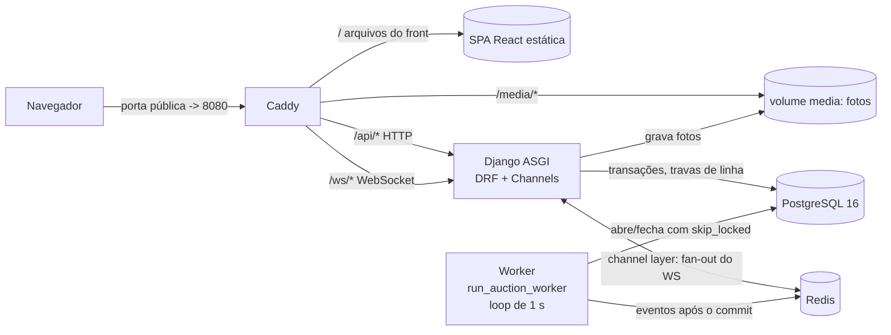
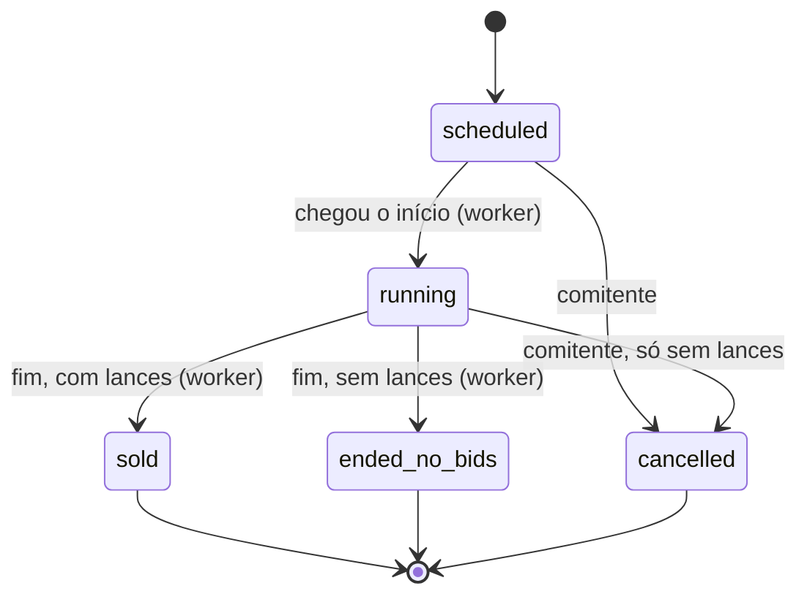

# Arquitetura

Resumo para o time e para o pitch. As regras estão no `AGENTS.md`; a API, no `docs/contract.md`.

## Componentes na VM



- **Uma porta só**: o Caddy é a única coisa exposta. Front, API, WebSocket e fotos na mesma origem, então não há CORS.
- **O banco é a fonte de verdade.** O Redis só distribui mensagens; se ele cair, nenhum lance se perde (a sala ressincroniza com `snapshot`).
- **O worker é um processo separado** e não guarda nada em memória: a cada segundo pergunta ao banco o que está atrasado. Por isso sobrevive a reinício (RF18).

## Um lance, do clique à sala

```mermaid
sequenceDiagram
    participant N as Navegador
    participant A as Django (POST /bids)
    participant P as PostgreSQL
    participant R as Redis
    participant S as Sala (WebSocket)
    N->>A: POST amount_cents + Idempotency-Key
    A->>P: BEGIN; SELECT leilão FOR UPDATE
    Note over A,P: Daqui até o COMMIT, ninguém mais dá lance,<br/>cancela ou fecha ESTE leilão.
    A->>P: chave já vista? (replay ou 422)
    A->>A: now = relógio do servidor (lido DEPOIS da trava)
    A->>A: running? now < ends_at? não é comitente? não é líder? valor >= mínimo de AGORA?
    A->>P: INSERT lance, UPDATE leilão (preço, líder, ends_at se prorrogou), INSERT idempotência
    A->>P: COMMIT
    A-->>R: on_commit: group_send(bid_accepted)
    R-->>S: bid_accepted para todos na sala
    A->>N: 201 (ou 409 com motivo + mínimo atual)
```

O que cada passo garante:

| Garantia | Como |
|---|---|
| Dois lances simultâneos nunca violam o valor (RF11) | `select_for_update` na linha do leilão serializa; o `UNIQUE(leilão, valor)` é rede de segurança |
| A sala nunca vê lance não gravado (RF11) | broadcast só em `transaction.on_commit` |
| Reenvio não duplica (RF12) | `UNIQUE(usuário, chave)` + resultado gravado (201 e 409) |
| Nada depois do fechamento, nem fechamento no meio de um lance (RF18) | lance, cancelamento e worker disputam a MESMA trava; lance exige `now < ends_at`, worker fecha com `now >= ends_at` |
| Sem erro de centavo (RF19) | inteiros em centavos do banco à API |

## Estados (RN01)



Só `auctions/services/transitions.py` altera `status`.

## Código do backend

```
backend/
  config/            settings (lê o .env), urls, asgi, health, formato de erro
  accounts/          usuário (e-mail único normalizado, UUID)
  auctions/
    rules/           regras PURAS, sem Django: lance mínimo, prorrogação, rótulo
    models.py        Item, Auction, AuctionParticipant, Bid, IdempotencyRecord
    services/        efeitos: bidding (lance), transitions (estados, worker), broadcast, clock
    management/commands/run_auction_worker.py
  tests/
    unit/            regras puras (rápidos, sem banco)
    todo/            garantias RF10–RF18 ainda vermelhas = lista de trabalho
```

Por que separar `rules/` de `services/`: a conta do lance mínimo e da prorrogação cabe em 20 linhas
e qualquer um do time explica para a banca sem falar de banco; a parte difícil (trava, transação,
idempotência) fica isolada em `services/`.
